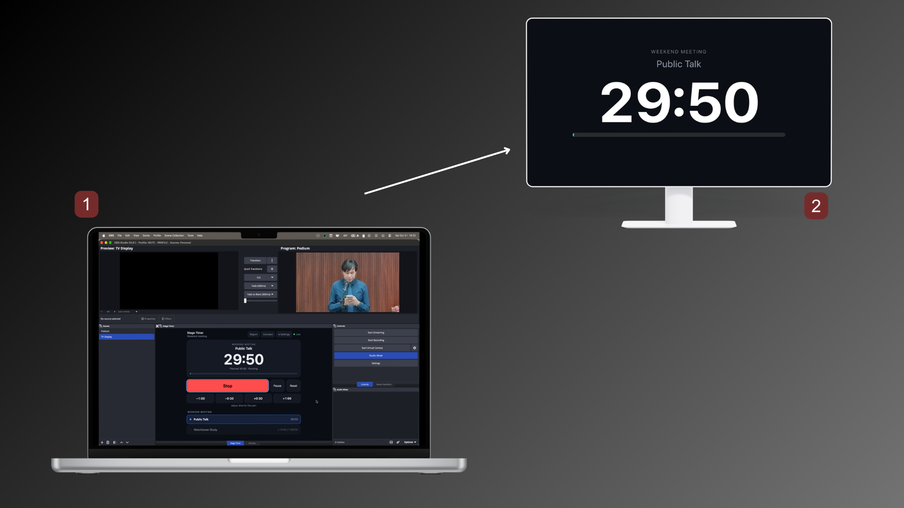
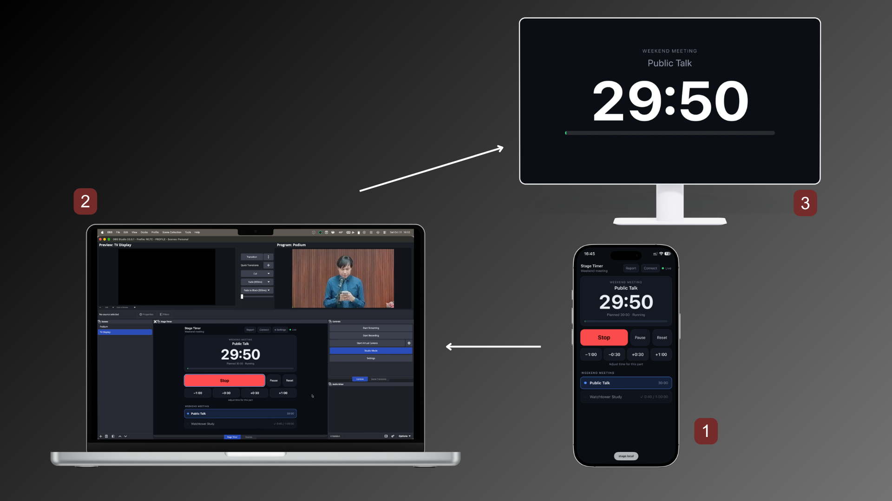
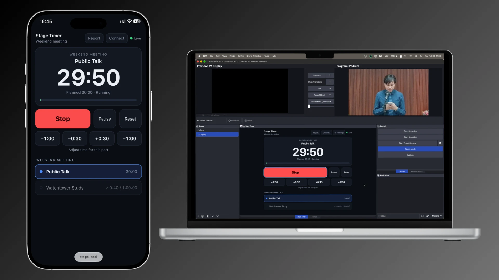
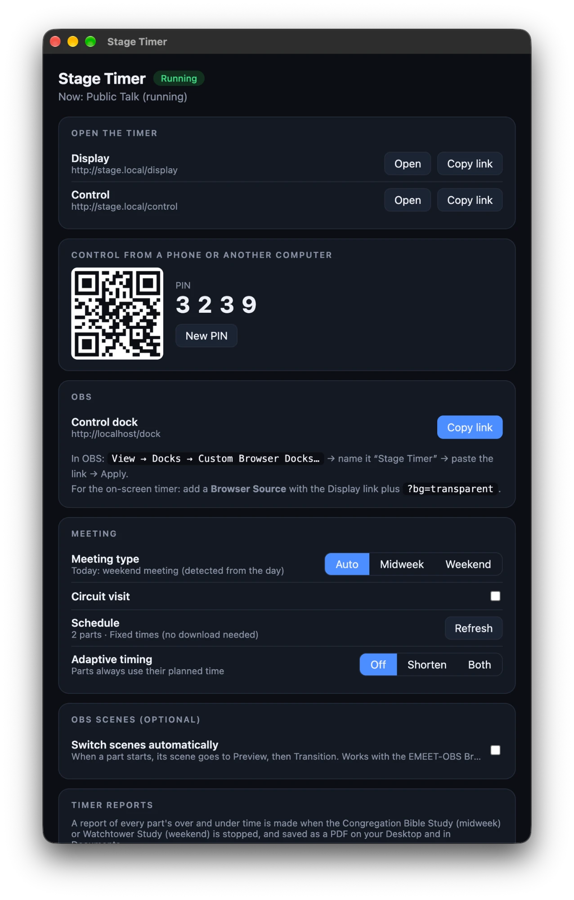
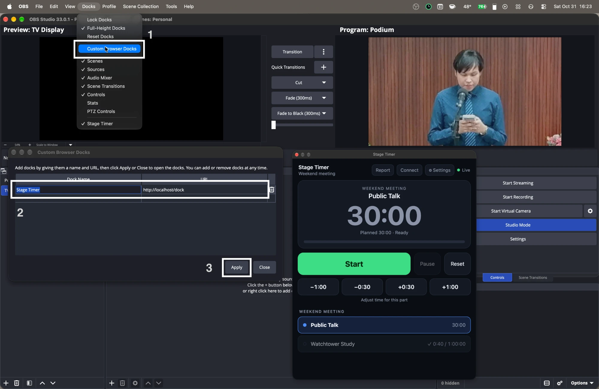
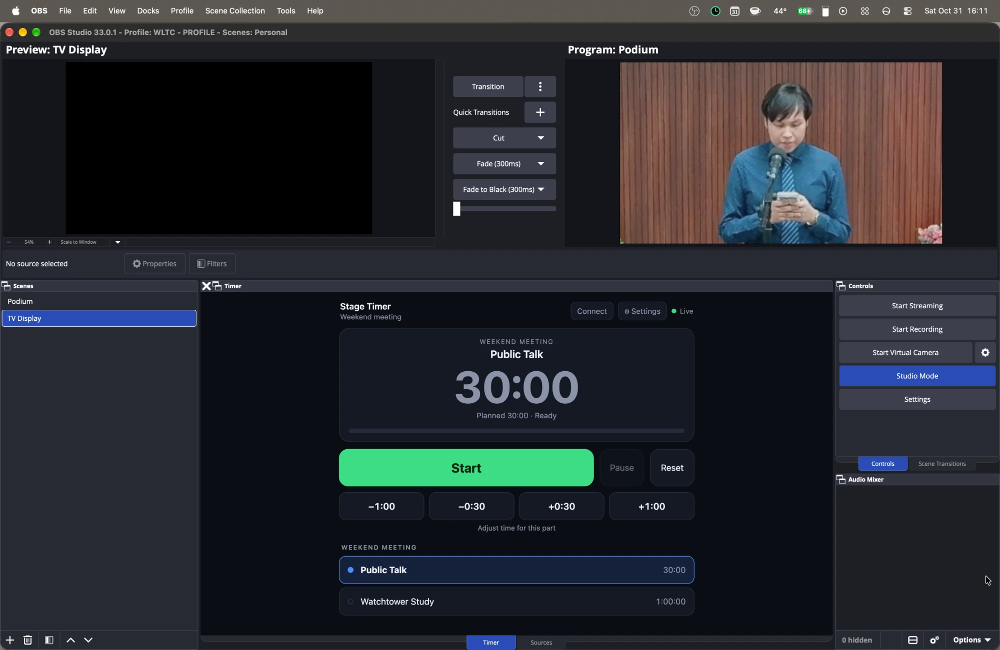
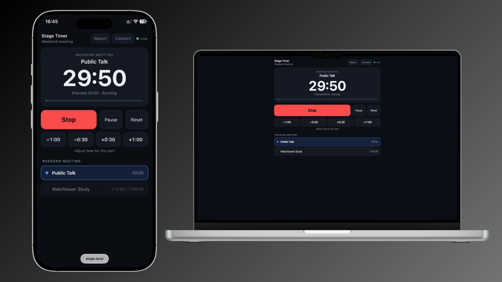
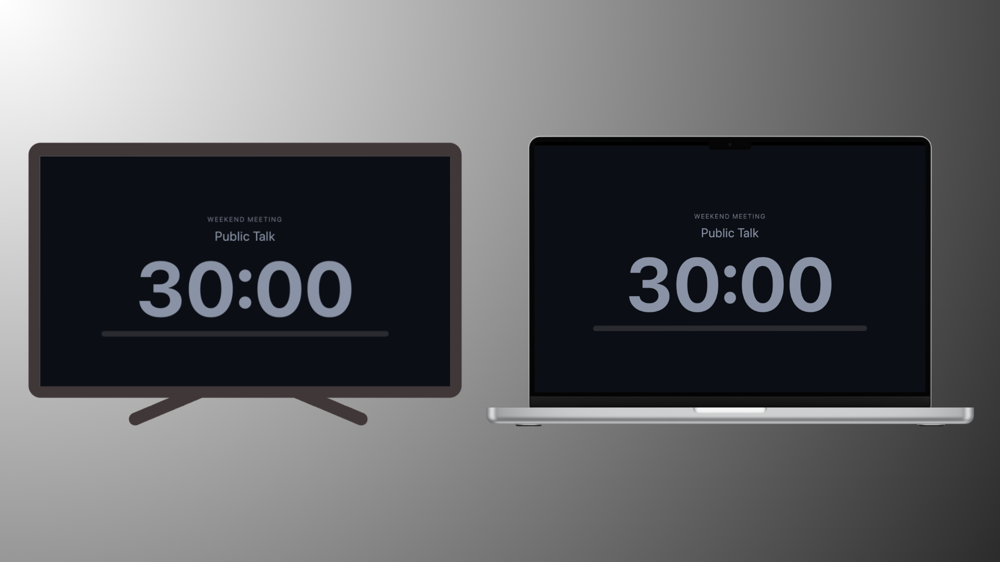

# Stage Timer

A meeting timer for the stage that you control from **OBS**, a phone, or any browser. It downloads the week's
schedule automatically, shows a clear countdown on any screen, and warns the speaker with flashing colours instead
of sounds or system notifications.

**[Download the latest Windows installer](https://github.com/carl-gian/Stage-Timer/releases/latest)** · [Release notes](RELEASE_NOTES.md)

> The installer isn't code-signed, so Windows SmartScreen will warn you. Choose **More info → Run anyway**.

## How it's used

**Laptop with OBS.** The OBS dock (1) controls the timer, and the display (2) goes to a web page or an HDMI screen, whichever you prefer.



**Add a phone.** The same timer can also be controlled from a phone (1), alongside the OBS dock (2). The display (3) stays in sync with both.



Everything stays in sync. Start a part on the phone and the OBS dock and the display follow instantly.



## What it does

- **Automatic schedule.** Fetches the week's parts and times (cached for offline use). Midweek or weekend is picked from the day, with a manual override and a circuit visit option.
- **Control from anywhere.** Start, Stop, Pause, Reset, ±30 s / ±1 min, and choose any part, from a phone, tablet or browser. Protected by a PIN.
- **OBS dock.** A compact control panel you can dock inside OBS, with a hidden Connect panel (QR code + PIN), a Report button and a button that opens the app's settings.
- **Display page.** A big, readable timer for any screen. It opens in your browser by default, or fullscreen on another monitor (for example a third screen) if you pick one under Advanced → *Show display on*. Press Esc to close it.
- **Easy links.** `http://stage.local/display`: no IP address or port to type.
- **Warnings you can see from the back of the room.** Amber glow with one minute left, flashing amber from 30 s, flashing red from 10 s, then a flashing "Time's up" pop-up.
- **OBS scene switching** (optional). Give each part an OBS scene; when the part starts, the scene is sent to OBS Preview and then Transitioned, like pressing the button in Studio Mode. See [OBS scene switching](#obs-scene-switching-optional).
- **Timer report.** When the Congregation Bible Study or Watchtower Study is stopped, a report of every part's over and under time is saved, shown on a printable page, and saved as a PDF.
- **Automatic updates.** New versions download in the background and install when you quit. It never restarts by itself.
- **Adaptive timing** (optional). If the meeting runs early or late, later parts are shortened or lengthened in proportion.

## Quick start

1. Install and open Stage Timer. The window shows your links, a QR code and the PIN.

   

2. **OBS control dock:** *View → Docks → Custom Browser Docks…*, name it "Stage Timer", paste `http://localhost/dock`, Apply.

   

   The timer now sits inside OBS:

   
3. **Phone or tablet:** scan the QR code (or click **Connect** in the dock) and enter the PIN. On the computer running OBS no PIN is needed.

Closing the window keeps Stage Timer running in the system tray. After the first launch it also starts hidden in the tray, without opening the window (click the tray icon to open it, or turn *Start hidden* off under Advanced).

## Pages

The control page works on a phone, a tablet, or a laptop browser tab:



The display works on any screen: a TV, a monitor, or a laptop:



| Page | Use |
|---|---|
| `/display` | The timer. Options: `?name=0` (hide part name) `?bar=0` (hide progress bar) `?mode=elapsed` (count up) |
| `/report` | The latest timer report (`?id=` for an earlier one). Printable |
| `/control` | Full control page for phones and tablets (PIN required away from the host computer) |
| `/dock` | The same control page, sized for an OBS Custom Browser Dock |

### Showing the display on another monitor

By default **Open** next to Display opens the timer in your browser. To put it on another physically connected monitor (a TV or a third screen), open Stage Timer's window and choose the monitor under **Advanced → Show display on**. **Open** (and *Open display* in the tray menu) then shows the timer fullscreen on that monitor. Press **Esc** to close it. If the chosen monitor isn't connected, it falls back to the browser. The display can still be used on any other screen or device with the Display link.

## How the timer behaves

- **Stop** finishes the part, records the time it took and lines up the next part. **Pause** keeps the part and its time.
- Warnings use in-page pop-ups and flashing only: no sound and no system notifications.
  - 1 minute left: amber glow (not for Opening Comments, or parts of 2 minutes or less)
  - 30 seconds: flashing amber
  - 10 seconds: flashing red
  - Time's up: flashing pop-up for 15 seconds, then steady red while over time
- **Adaptive timing** is off by default (Settings: Off / Shorten / Both). When on, the difference between the clock and the planned end of the meeting is shared across the remaining adaptive parts (the "Living as Christians" parts, the Congregation Bible Study and the weekend talks after the first) in proportion to their length.

## OBS scene switching (optional)

Off by default. When on, starting a part puts its scene on air using OBS Studio Mode: **Set Preview scene → short wait → Transition**. It goes through Preview, rather than jumping straight to Program, so tools that react to Preview and the Transition button (such as the EMEET-OBS Bridge, which moves the camera) behave exactly as if you had pressed Transition yourself. Stage Timer never changes the transition itself.

1. In OBS: turn on **Studio Mode**, and under *Tools → WebSocket Server Settings* enable the server (note the port and password).
2. In Stage Timer's window, open **OBS scenes**, tick *Switch scenes automatically*, and enter the address (default `ws://localhost:4455`) and password.
3. Pick a scene for each part. Scenes are listed from OBS, so names always match exactly. Parts left on *None* are never touched.

Details worth knowing:

- **When a part is stopped** you can also send a default scene (for example the full stage shot) so OBS isn't left on the last part's scene. Pick it under *When a part is stopped*; *None* leaves OBS alone. Only Stop does this, not Pause or Reset. Midweek also has a separate **Counseling in Apply Yourself** scene: after a student talk in *Apply Yourself to the Field Ministry* is stopped (when the counsel is given), OBS goes to that scene instead of the default one.
- **Change scenes on the fly.** The control page and dock show a *Scene for this part* picker for the current part. Choosing a scene while the part is running puts it on air immediately; choosing one before it starts saves it for when it starts. Student talks in Apply Yourself also get a *Counseling scene* picker, set per part, used when you press Stop. The choices are saved for next time.
- Only the **start** of a part switches scenes. Resuming after a pause does not, and a scene that is already on air is left alone.
- **Wait before Transition** (default 300 ms) gives another program time to react to the new Preview scene and pick its transition. If the wait is too short, OBS uses the previous transition. The wait ends early, after a short grace, as soon as OBS reports that the transition changed. Tune it on your own setup.
- Switches never overlap: if you start another part while a transition is running, it waits for the transition to end, and only the most recent request runs.
- Problems (OBS not running, wrong password, Studio Mode off, a scene that no longer exists) show in the settings window and as a banner in the control page and dock. The timer itself is never held up by OBS.

## Timer report

A report is saved when the **Congregation Bible Study** (midweek) or the **Watchtower Study** (weekend) is stopped. Concluding Comments does not make one. It lists every part with its planned time, actual time and how far over or under it ran, plus the net total for the meeting. Parts not yet timed show as "Not timed" and are left out of the totals.

- Over and under are measured against the time the clock was actually counting to, so any ±30 s / ±1 min adjusting or adaptive timing is taken into account. The report shows a *Target* column when any part differed from plan.
- Open it from the **Report** button in the control page and dock, or from the *Timer reports* card in Stage Timer's window, which also has **Make a report now** (handy for a circuit visit week, when the Bible Study isn't held).
- A part only counts as timed when you press **Stop** on it (Pause alone does not).
- Each report is also saved as a PDF named like `MIDWEEK Time Report 10-27-2026.pdf` (or `WEEKEND …`; month-day-year) on your **Desktop** and in **Documents** (two copies). A second report on the same day gets `(2)` added rather than replacing the first.
- Reports are also kept as small data files in the app's data folder (`reports/`), so earlier weeks stay available on the report page.

## Updates

On the Windows installer, Stage Timer checks GitHub for a newer release shortly after it starts and every few hours, downloads it quietly, and installs it **when you quit the app**. It never restarts by itself, and *Restart and update* is disabled while the timer is running. You can turn this off, or check by hand, under *Updates* in the app window. The installer isn't code-signed, so updates are trusted on the strength of the GitHub release they come from.

## Links, ports and networking

Stage Timer announces itself on your local network as `stage.local` (you can change the name in Settings), so other devices can open
`http://stage.local/display` and `http://stage.local/control`. It uses port 80 when available and falls back to 4580. Everything stays on your
local network; the app is not exposed to the internet.

If `stage.local` doesn't work (some guest or "client isolation" Wi-Fi blocks device discovery), use the IP address link shown in the app.

The only outgoing request is the schedule download, a single JSON file from the same feed [OnlyT](https://github.com/AntonyCorbett/OnlyT) uses.

## Remote API

The control page uses a small HTTP API you can call yourself (send the PIN in an `x-pin` header, except from the host computer):

| Method | Path | Body |
|---|---|---|
| GET | `/api/state` | Current timer state (JSON) |
| GET | `/api/events` | Live state stream (Server-Sent Events) |
| POST | `/api/timer/start` · `stop` · `pause` · `reset` | none |
| POST | `/api/timer/select` | `{ "talkId": 3 }` |
| POST | `/api/timer/adjust` | `{ "deltaSeconds": -30 }` |
| POST | `/api/timer/refresh` | re-download the schedule |
| POST | `/api/timer/report` | make a timer report now |
| GET | `/api/report` · `/api/reports` | the latest (or `?id=`) report · list of reports |

## Build from source

Requires [Node.js](https://nodejs.org) 22 or later.

```bash
npm install
npm start          # desktop app (tray + settings window)
npm run serve      # headless server, no Electron
npm test
npm run dist       # build an installer for the current OS
```

Releases are built by GitHub Actions: pushing a tag like `v1.0.1` builds the Windows installer and attaches it to a release.

```
src/core/      timer, schedule, feed download, adaptive timing, HTTP server, mDNS, OBS scene switching
src/main.js    Electron main process (tray, settings window)
src/renderer/  settings window
web/           display and control pages
test/          unit and API tests
```

## Credits and licence

Stage Timer's schedule feed, part timings and adaptive timing logic are ported from
[OnlyT](https://github.com/AntonyCorbett/OnlyT) by Antony Corbett. This is an independent project and is not affiliated with or endorsed by OnlyT or its author.

Released under the [MIT licence](LICENSE).
